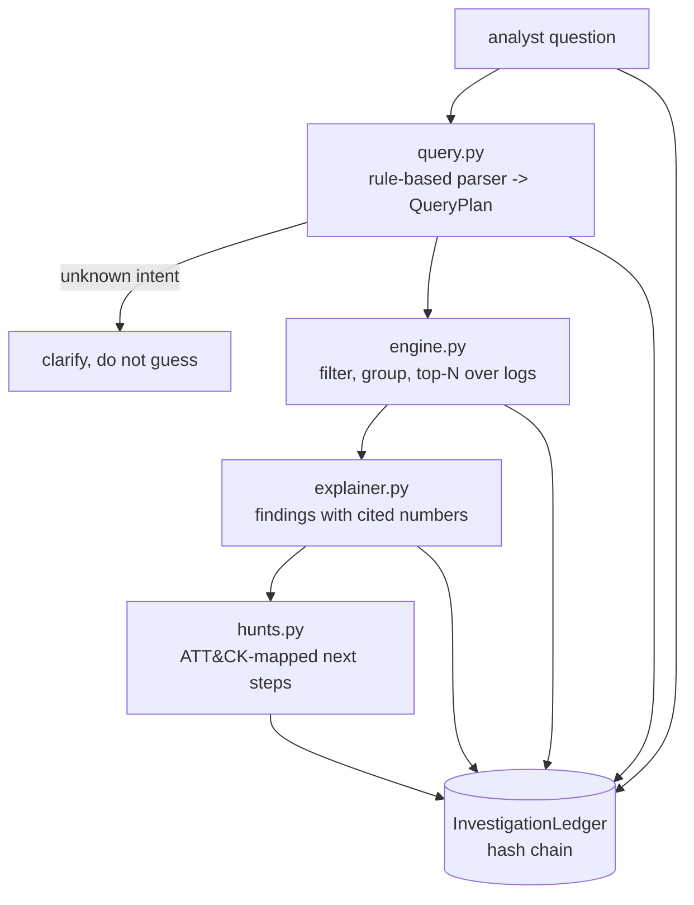

# Jagadish-soc-analyst-copilot

[](https://github.com/jagadishmazure-jpg/Jagadish-soc-analyst-copilot/actions/workflows/ci.yml)
[](https://github.com/jagadishmazure-jpg/Jagadish-soc-analyst-copilot/actions/workflows/codeql.yml)


**A natural-language investigation copilot for SOC analysts: plain-English question, inspectable query plan, deterministic execution over security logs, findings that cite numbers, ATT&CK-mapped next steps.**

> Personal learning and portfolio project. Everything runs offline on synthetic,
> fictional data with no API keys. Nothing is deployed. Numbers in this README
> come from real runs and are re-checked by CI (`scripts/render_docs.py --check`).

## Recruiter summary

- Analyst asks in plain English; the copilot shows its plan, runs it over auth, firewall and endpoint logs, explains with cited counts and suggests the next hunt.
- Real run: 50 failed logons for one user (47 from one IP, 5x baseline) flagged as a brute-force burst; mimikatz.exe found as a never-seen process; an off-topic question gets a clarify response instead of a guess.
- Every step on a hash-chained ledger; offline tests, CI with CodeQL and gitleaks.

## Purpose

Query languages such as KQL take months to learn, and many AI security tools
either guess or cannot show their work. This copilot takes the middle path: parsing
and execution are deterministic, and the analyst sees the plan and the raw numbers
behind every claim. It is a study of the analyst-facing half of an AI SOC, on
synthetic logs.

## Architecture



## How it works

| Ask about | Example |
|---|---|
| Failed logons (optionally for one user) | "failed logons for jdoe last 24 hours" |
| Logons by user | "logons by asmith" |
| Network traffic (optionally from one IP) | "traffic from 185.220.10.4", "top talkers" |
| Suspicious processes | "any rare processes running?" |
| Summary | "summarize the last 2 days" |

Time windows are "last N hours" or "last N days" (default 24 hours), measured
back from the newest log record. Findings compare against per-user baselines.
Hunt suggestions are keyed to finding patterns and mapped to MITRE ATT&CK tactics
in [docs/hunt-playbooks.md](docs/hunt-playbooks.md). `LLMParser` is a stub with
the same `QueryPlan` interface, for swapping in function calling later.

The demo also shows a gap honestly: six injected logons from an unusual country
for `asmith` sit below the 30% share trigger among 64 logons, so the copilot does
not flag them.

## Real code and output

```python
"""Ask the copilot plain-English questions over synthetic logs with three injected attacks (offline)."""
from soc_copilot import (
    Copilot,
    LogStore,
    gen_auth_logs,
    gen_endpoint_logs,
    gen_firewall_logs,
    inject_brute_force,
    inject_rare_process,
    inject_unusual_geo,
)

auth = inject_unusual_geo(inject_brute_force(gen_auth_logs(500), user="jdoe", count=47), user="asmith")
store = LogStore(auth=auth, firewall=gen_firewall_logs(500), endpoint=inject_rare_process(gen_endpoint_logs(300)))
copilot = Copilot(store)

questions = [
    "show me failed logons for jdoe in the last 48 hours",
    "logons by asmith",
    "logons by asmith in the last 48 hours",
    "any rare processes running?",
    "what is the weather like",
]
for q in questions:
    inv = copilot.investigate(q)
    print(f"Q: {q}")
    print(f"Plan: {inv.plan_text}")
    print(f"Findings: {inv.findings}")
    for s in inv.suggestions[:2]:
        print(f"  next: {s}")
    print(f"Ledger: {inv.ledger.kinds()} verifies={inv.ledger.verify_chain()}\n")
```

Output of `python examples/demo.py` (real run, re-checked in CI):

<!-- run: python examples/demo.py -->
```text
Q: show me failed logons for jdoe in the last 48 hours
Plan: I will search auth logs for user 'jdoe' with result=failed over the last 48h.
Findings: 50 failed logons for 'jdoe' in the last 48h, 5x the per-user baseline of 10.8. Top sources: 185.220.10.4 (47), 10.7.102.216 (1), 10.18.56.50 (1). Pattern is consistent with a brute-force burst: investigate urgently.
  next: Check whether any logons from 185.220.10.4, 10.7.102.216, 10.18.56.50 SUCCEEDED (a brute-force burst followed by success means compromise).
  next: Block or rate-limit the offending source IPs at the perimeter and force a password reset for the targeted account(s).
Ledger: ['question', 'plan', 'result', 'explanation', 'suggestions'] verifies=True

Q: logons by asmith
Plan: I will search auth logs for user 'asmith' over the last 24h.
Findings: 37 logons for 'asmith' in the last 24h: 37 successful, 0 failed.
Ledger: ['question', 'plan', 'result', 'explanation', 'suggestions'] verifies=True

Q: logons by asmith in the last 48 hours
Plan: I will search auth logs for user 'asmith' over the last 48h.
Findings: 64 logons for 'asmith' in the last 48h: 63 successful, 1 failed.
Ledger: ['question', 'plan', 'result', 'explanation', 'suggestions'] verifies=True

Q: any rare processes running?
Plan: I will search endpoint logs for rare or suspicious processes over the last 24h.
Findings: 2 executions of rare processes in the last 24h: 'mimikatz.exe' (x2). These never appear in the baseline: treat as suspicious until cleared.
  next: Trace the parent process lineage of 'mimikatz.exe' and check prevalence across the fleet (one host = targeted, many hosts = worm/tooling).
  next: Pull the full command line and any files written by the process for malware triage.
Ledger: ['question', 'plan', 'result', 'explanation', 'suggestions'] verifies=True

Q: what is the weather like
Plan: I couldn't map that to a known investigation. Try asking about failed logons (optionally for a user), network traffic from an IP, suspicious processes, or a summary.
Findings: I couldn't map that to a known investigation. Try asking about failed logons (optionally for a user), network traffic from an IP, suspicious processes, or a summary.
Ledger: ['question', 'plan', 'result', 'explanation', 'suggestions'] verifies=True
```
<!-- /run -->

## How to run

```bash
git clone https://github.com/jagadishmazure-jpg/Jagadish-soc-analyst-copilot.git
cd Jagadish-soc-analyst-copilot
python -m pip install pytest      # no runtime dependencies
python -m pytest -q          # offline, no keys
python examples/demo.py
python scripts/render_docs.py --check   # documented output still matches
```

Test suite size (real collection, re-checked in CI):

<!-- run: python scripts/count_tests.py -->
```text
29 tests collected
```
<!-- /run -->

## Guardrails

- Read-only: the copilot queries logs and suggests actions; it never blocks an IP or resets a password.
- Unknown questions get a clarify plan, never a guessed query.
- Every finding cites the counts it is based on, so the analyst can check them against raw rows.
- Question, plan, result, explanation and suggestions are each recorded on a hash-chained ledger.
- All logs are synthetic and seeded.

## Limitations

- The parser is rule-based and covers five intents; it does not generate KQL yet.
- The unusual-geo trigger needs over 30% of a user's activity from the odd geo, so a small burst (6 of 64 logons in the demo) is missed.
- Logs are in-memory lists; there is no SIEM connector.
- Overlaps with Jagadish-azure-ai-soc, which covers triage, investigation and containment in more depth.

## Built vs planned

| Capability | Status | Where |
|---|---|---|
| Rule-based NL parser with clarify path | Built | `soc_copilot/query.py` |
| Execution, explanation and hunt suggestions | Built | `soc_copilot/engine.py`, `explainer.py`, `hunts.py` |
| Hash-chained investigation ledger | Built | `soc_copilot/audit.py` |
| LLM parser with function calling | Stub only | `soc_copilot/query.py::LLMParser` |
| KQL generation and validation against Log Analytics | Planned | docs/implementation-guide.md |
| Sentinel connector | Planned | docs/implementation-guide.md |

## Implementation guide

The step-by-step path from this offline build to an Azure deployment is in
[docs/implementation-guide.md](docs/implementation-guide.md). None of it has been
run; it is a plan.

## Related repositories

| Repo | How it relates |
|---|---|
| [Jagadish-azure-ai-soc](https://github.com/jagadishmazure-jpg/Jagadish-azure-ai-soc) | The fuller agentic SOC: multi-tenant triage, investigation, ATT&CK, approved containment |
| [Jagadish-ai-soc-assurance](https://github.com/jagadishmazure-jpg/Jagadish-ai-soc-assurance) | Benchmarks and audits for AI SOC tools like this copilot |
| [Jagadish-agent-security-redteam](https://github.com/jagadishmazure-jpg/Jagadish-agent-security-redteam) | Prompt-injection and tool-abuse tests relevant to an LLM-backed parser |
| [Jagadish-text2sql-data-agent](https://github.com/jagadishmazure-jpg/Jagadish-text2sql-data-agent) | The same NL-to-query problem with a SQL safety guard |

## Documentation

- [Hunt playbooks (ATT&CK-mapped)](docs/hunt-playbooks.md)
- [Implementation guide (Azure)](docs/implementation-guide.md)
- [Interview points](docs/interview-points.md)
- [Security policy](SECURITY.md)

## Project layout

```
soc_copilot/
  logs.py       seeded synthetic auth/firewall/endpoint logs + attack injectors
  query.py      rule-based NL parser -> QueryPlan (+ LLMParser stub)
  engine.py     plan execution
  explainer.py  findings with cited numbers
  hunts.py      next-step suggestions
  audit.py      hash-chained ledger
  agent.py      Copilot.investigate()
examples/demo.py the run shown above
tests/           offline pytest suite
```

## License

MIT, see [LICENSE](LICENSE). All data is synthetic; every organisation and person is fictional.
